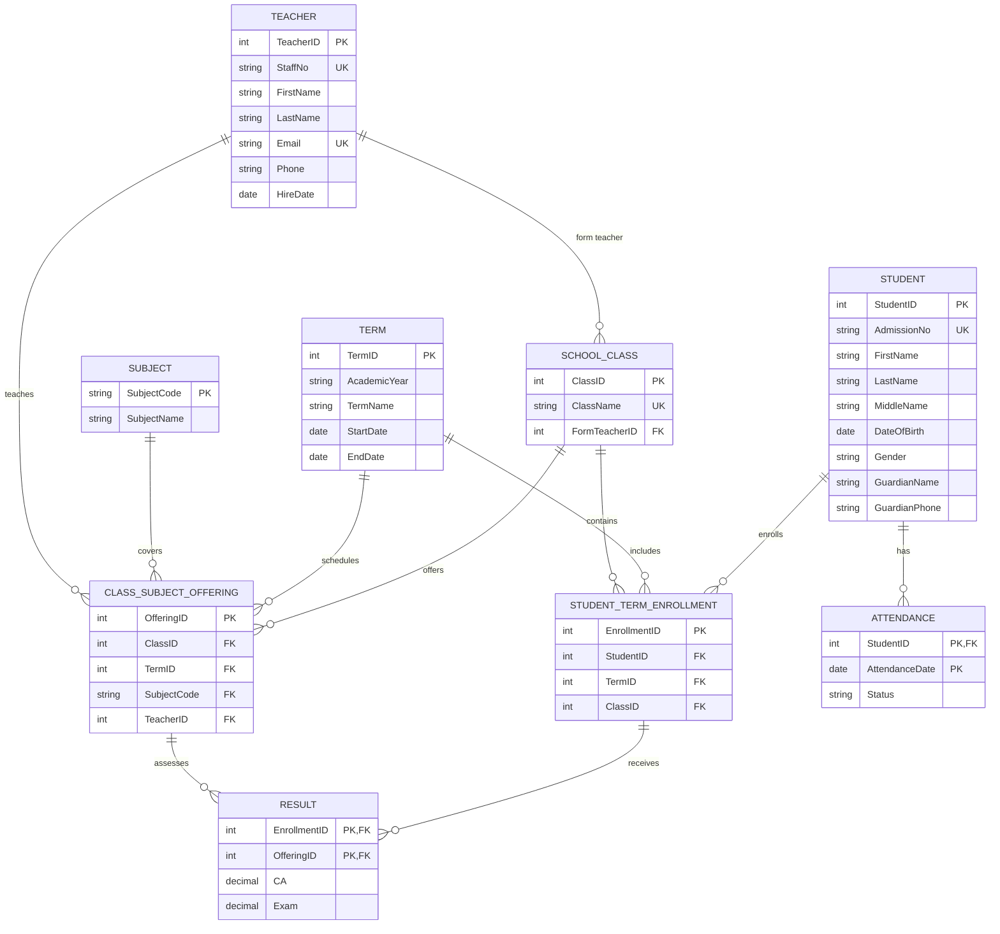

# School Database

MySQL/MariaDB school database using InnoDB and `utf8mb4`.

## Load the database

1. Create an empty database in MySQL or MariaDB, for example `school_database`.
2. Select that database in phpMyAdmin before importing each file.
3. Import files in this order:
   1. `schema.sql` — creates the tables and result-validation triggers.
   2. `seed.sql` — inserts sample teachers, classes, subjects, students, a term,
      enrollments, subject offerings, results, and attendance.
   3. `indexes.sql` — first displays the baseline plans, adds optional indexes,
      then displays the plans again. Run this file once; save the baseline
      output before applying its index statements.
   4. `transactions.sql` — creates the class-transfer audit table and the
      guarded `sp_move_student` procedure. The simple transaction is commented
      out to avoid changing sample data during import; uncomment it only when
      ready to run it.
   5. `procedures.sql` — creates `sp_record_result`.
   6. `queries.sql` — contains the example reports and creates two views.

You can import each `.sql` file from phpMyAdmin's **Import** tab after selecting
the database. With a MySQL command-line client, select the database in the
command so scripts that do not contain `USE` run against the intended database:

```text
mysql -u your_user -p school_database < schema.sql
mysql -u your_user -p school_database < seed.sql
```

Repeat that command pattern for the remaining files in the order above. Use a
MySQL version that enforces `CHECK` constraints; for MySQL, that is 8.0.16 or
newer.

## File guide

| File | Purpose |
|---|---|
| `schema.sql` | Normalized core tables, constraints, foreign keys, and triggers. |
| `seed.sql` | Realistic sample data: 30 students, 3 classes, 8 subjects, 6 teachers, and sample term activity. |
| `queries.sql` | Eight explained reporting queries and views `v_student_results` and `v_class_summary`. |
| `indexes.sql` | Before/after `EXPLAIN` statements and indexes for three reports. |
| `transactions.sql` | Transfer audit table, transfer examples, and guarded `sp_move_student`. |
| `procedures.sql` | Validated `sp_record_result` upsert procedure. |

## ERD



## Three useful queries

1. **Class position using `RANK()` (query 3 in `queries.sql`)**: first groups
   subject scores into one average per student, then partitions the ranking by
   class and term. Equal averages share a rank, which is useful when students
   tie. The file also provides a correlated-subquery alternative for MySQL
   versions before 8.0.
2. **Finding students with multiple failed subjects (query 5)**: `GROUP BY`
   makes one group per student, `SUM(CASE ...)` counts failing marks, and
   `HAVING` filters those aggregates. `WHERE` cannot filter on an aggregate
   because it runs before grouping.
3. **Attendance below 80% (query 7)**: a derived table calculates the
   percentage for each student, then the outer query filters that percentage.
   In this example, both Present and Late count as attended and the denominator
   is days with an attendance record during the term.

## Performance and integrity notes

- In `EXPLAIN`, `type` describes access (for example `const`, `ref`, `range`,
  or `ALL`); `key` is the index the optimizer selected, or `NULL` if none; and
  `rows` is the optimizer's estimated rows examined, not the exact count.
- Compare the before/after plans in `indexes.sql` on your own populated
  database. Tiny sample tables may lead MySQL to choose a table scan even when
  an index exists; index choice depends on table size and data distribution.
- The new enrollment and result indexes are candidates for the term-ranking
  and failure reports. The date-first attendance index is designed to make the
  term date range a `range` lookup instead of scanning the student-first
  attendance primary key. Confirm the optimizer's actual `key` and `rows` on
  your dataset; the optimizer is free to choose a different plan.
- A trigger in `schema.sql` prevents changing a student's class or term after
  results have been recorded. This protects the rule that a result must match
  the class and term of the student's enrollment.
- `sp_record_result` validates the student enrollment, subject offering, and
  score limits, then inserts or updates the unique enrollment/offering result.
  It owns its transaction, so call it outside another application-managed
  transaction.
- `sp_move_student` locks the current enrollment and writes the transfer audit
  entry and class update together. It refuses to move a student after results
  have been recorded for that enrollment, so results cannot become linked to
  offerings for the wrong class. If the target class or enrollment is invalid,
  it raises an error and rolls back.

## Export the full database in phpMyAdmin

1. Select the database in the left navigation pane.
2. Open **Export**.
3. Choose **Custom** if you want to confirm every table is selected; keep all
   tables and views selected. Include triggers, routines/procedures, and events
   if those options are shown by your phpMyAdmin version.
4. Choose **SQL** as the format. Leave structure and data enabled to include
   both object definitions and rows.
5. Click **Export** (or **Go**, depending on phpMyAdmin version) and save the
   downloaded file as `database.sql`.
